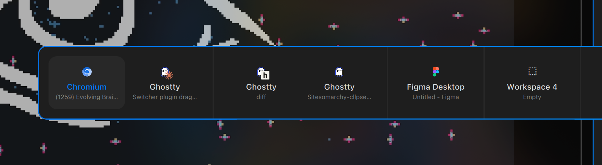

# Window Switcher

A macOS-style window switcher for the [Omarchy](https://omarchy.org) 4
(Quickshell) shell. Hold `SUPER`, tap `TAB` to cycle a horizontal strip of open
windows, release to focus the highlighted one — or throw the pointer into any
corner of the screen and the same strip opens with no key held. Click a tile to
focus it, or drag one onto another workspace to move it there.



- **Tiles are grouped by workspace** and sorted by on-screen position, with a
  rule between groups. Empty workspaces get a tile of their own, so a blank
  desktop is reachable without a separate keybind.
- **`SUPER+TAB` alternates**, the way every Alt-Tab does: the first tap lands on
  the window you came from, further taps in the same gesture walk the strip.
  The tiles are never reordered to do it.
- **Drag a tile onto a workspace group** to move that window there, landing at
  whichever boundary you drop on — before its first window, after its last, or
  between any two. Dropping on a tile's own group re-arranges it in place.
- **Drag a tile onto another window's tile** to split that window with it, on
  any workspace and without switching to it. Drop in the tile's top third and
  the window goes above it, in the bottom third below it, in the middle third
  beside it, on the side the pointer is on.
- **Drag a workspace's handle to re-arrange the workspaces.** Point at a
  workspace and a handle fades in under the card beneath it; carry it to another
  place in the row and the workspace moves there, with the ones in between
  shifting along. Its windows, its layout and its split sizes come with it
  untouched.
- **While you drag over a workspace, a blue dot on each of its tiles shows
  where that window sits**: top-left, top, bottom-right and so on. A window
  alone on its workspace has none.
- **A terminal tile shows what is running in it** — a Claude session, a diff
  viewer, `btop` — as a small icon over the terminal's own.
- **A browser tile shows the favicon of the site it is on**, in that same
  corner, so four browser windows are told apart by where they are rather than
  by reading four truncated titles.

## Requirements

- Omarchy 4 (Quattro) and its Quickshell-based shell
- Hyprland, for `hyprctl` and the global-shortcuts protocol
- A Nerd Font as the shell's menu font, for the tile glyphs
- For site favicons only: `python3` with its `sqlite3` module (on Arch that is
  the `sqlite` package, an optional dependency of `python`). Without it every
  browser tile simply keeps its own icon and nothing else changes.

## Install

```bash
omarchy plugin add https://github.com/cllpse/omarchy-cllpse-plugin-switcher.git --enable
```

**Then install the keybinds.** Without them the only way in is the screen
corners (below) — the keyboard half registers three global shortcuts and waits
for the compositor to send them. Append
[`hypr/window-switcher-bindings.lua`](hypr/window-switcher-bindings.lua) to
`~/.config/hypr/bindings.lua`:

```bash
cat ~/.config/omarchy/plugins/cllpse.window-switcher/hypr/window-switcher-bindings.lua \
  >> ~/.config/hypr/bindings.lua
hyprctl reload
```

That file binds `SUPER+TAB` / `SUPER+SHIFT+TAB`, polls for the release of
`SUPER` to commit, and switches Omarchy's `SUPER + mouse:272` "Move window" bind
off while the strip is up so that clicks and drags reach the switcher instead.
It unbinds Omarchy's default `SUPER+TAB` (next workspace) first.

Optionally append
[`hypr/window-switcher-looknfeel.lua`](hypr/window-switcher-looknfeel.lua) to
`~/.config/hypr/looknfeel.lua` for a fade as the strip opens and closes. It
deliberately leaves blur off: on a full-screen layer it halves the frame rate of
every animation, and an opaque card has nothing to blur. The file explains, and
carries the rule commented out:

```bash
cat ~/.config/omarchy/plugins/cllpse.window-switcher/hypr/window-switcher-looknfeel.lua \
  >> ~/.config/hypr/looknfeel.lua
hyprctl reload
```

## Remove

```bash
omarchy plugin remove cllpse.window-switcher
```

Then delete the blocks you appended from `~/.config/hypr/bindings.lua` and
`~/.config/hypr/looknfeel.lua` and run `hyprctl reload`. Removing the bindings
block restores Omarchy's own `SUPER+TAB` and `SUPER + mouse:272` behaviour,
since this plugin only ever *rebinds* them at the end of your config. The plugin
writes nothing else of its own: no state files, no edits to `shell.json` beyond
the entry `omarchy plugin add --enable` makes for you. The one file it touches
is Omarchy's: re-arranging workspaces moves Omarchy's per-workspace layout files
along with the workspaces (see *Re-arranging workspaces*), and those stay
Omarchy's after removal.

## Using it

| | |
|---|---|
| `SUPER+TAB` | open the strip / step forward |
| `SUPER+SHIFT+TAB` | step back |
| release `SUPER` | focus the highlighted window |
| pointer into **any screen corner** | open the strip, no key held |
| move the pointer | highlight the tile under it, once it has moved 16px and not within a quarter of a second of a key |
| scroll wheel | scroll the strip sideways when it is wider than the card, gliding to a stop like an ordinary list |
| `SUPER` + click a tile | focus that window |
| `SUPER` + click beside the card | dismiss without switching |
| `SUPER` + drag a tile | move that window to the workspace you drop on |
| `SUPER` + drag a tile onto another window's tile | split that window: above, beside or below it, by the third of the tile you drop in |
| `SUPER` + drag a handle under the card | move that workspace to the place you drop it; the ones in between shift along. Releasing `SUPER` afterwards switches nothing |

Opened from a corner there is no key to release, so nothing is
pre-selected: the strip opens on the window you are already in, and a click is
what chooses. Click a tile to focus it, click beside the card to dismiss. The
same drag works — hold the pointer down on a tile and drop it on a workspace.

### A pointer resting on the strip

A quick `SUPER+TAB` goes back to the window you came from, wherever the pointer
happens to be. Hover only takes the highlight once the pointer has travelled
more than twice Qt's drag distance (16px; Qt's own menus use the 8px) and no
sooner than 250ms after a key press (half what GNOME's switcher waits). Motion
during those 250ms does not count toward the 16px, so a mouse knocked during the tap
cannot take over later on its own. Each `TAB` hands the highlight back to the
keyboard until the pointer moves again. A click is never held back, and a strip
opened from a corner follows the pointer from the start.

### The screen corners

A one-pixel layer surface sits in each corner of every screen; crossing into one
opens the strip. Nothing polls — the compositor sends a single pointer-enter
event when the cursor crosses in, so the trigger costs nothing while you are not
touching it. A high mouse polling rate does not change that: a rate is reports
*while the mouse moves*, and a pointer resting in a corner generates no events
at all (measured at 8000Hz against the full-height edge this replaced: ~0 events
over 32s parked; ~500/s while sliding along it, under 4µs of client CPU each).

Hyprland clamps the cursor to the output, and in a corner it clamps in both axes
at once, so a fast throw cannot overshoot a one-pixel target the way it would
anywhere else on screen — measured on a 3072×1280 logical output, a warp to
(99999, 99999) lands at `3071, 1279`, and on a 2880×1620 one at `2879, 1619`.
That clamp is what makes one pixel enough.

Each set of four is bound to its output, the way Omarchy's own bar is. They
used to name no output, and a modeset that briefly drops the link (a scale
change on a TV behind a USB-C→HDMI adapter does) recreated them on Hyprland's
temporary `FALLBACK` output, where they died with it — the corners stayed dead
until the shell restarted. Bound, they are rebuilt when the output comes back.

It was the whole left edge first. A corner is the same gesture with the
accidents taken out: an edge is crossed by anything that overshoots a window's
left side, a scrollbar or a tab strip, and each of those opened the switcher
over work aimed somewhere else.

Two things it costs, both deliberate:

- The four corner pixels no longer pass clicks through to what is behind them.
  With Omarchy's default gaps the nearest window corner is 12px in (`gaps_out`
  10 plus a 2px border; 26 under omarchy-cllpse-macos's 24px gaps), so what is
  behind them is the wallpaper.
- It stands down while a window on the focused workspace is fullscreen, so a
  video or a game cannot be interrupted by a pointer thrown into a corner.

Dragging shows a caret at the boundary the window would land on. Drop outside
the card and nothing happens. The strip auto-scrolls when you drag against
either edge.

Arranging works on a workspace laid out as one row or one column. A workspace
mixing horizontal and vertical splits has no ordering a single strip of tiles
could point at, and none is invented — the move simply stops when the layout
declines it. Dropped onto a window instead, there is a second offer that needs
no ordering, below.

### Splitting a window

Over another window's tile, a drop is aimed at that window rather than at a
boundary. The tile is cut into thirds: the top one puts the dragged window above
it, the bottom one below it, and the middle one beside it, on whichever half of
the tile the pointer is over. A bar along the tile's top or bottom edge, at the
weight of the rule between workspace groups, or the caret at its side, marks
where the window will go. The dragged chip turns translucent so it does not hide
that bar. The window takes half of the one it splits, which is how dwindle opens
any window, and it can come from any workspace and go to any workspace.

Hyprland has nothing that says "open this window against that one", so the
plugin arranges for the path a window takes into the layout to pick the target
and the side, then floats the dragged window and tiles it again to send it
through. That path works differently on the workspace you are looking at and on
the others, so there are two ways in, both one `hyprctl eval` chunk:

- **On screen**, a new window splits the focused one, on the side `preselect`
  names. So the target is focused for the moment, the side preselected, and
  focus handed back to the window that had it. `preselect` reaches only the
  visible workspace, which is why this one cannot be used elsewhere.
- **Off screen**, it splits the window nearest the pointer, and with dwindle's
  `smart_split` on, the pointer's place relative to that window's centre picks
  the side. So `smart_split` is switched on for the moment and the pointer put
  inside the target on that side, then both go back as they were. Nothing is
  focused and the workspace you are on does not change.

Hyprland runs a chunk in one pass, so nothing is drawn with the target focused,
the window floating or the pointer moved. With `cursor:no_warps` off, focusing a
window warps the pointer to it, and the chunk puts the pointer back either way.
Floating windows have no split to join, so their tiles keep the boundary drop,
as do workspaces with a fullscreen window and workspaces using a layout other
than dwindle, whose splits neither way can steer.

### Where each window sits

While a drag is over a workspace, a blue dot on each of its tiles marks where
that window is on it, and no other tile shows one: in a corner for a quarter, at
the middle of an edge for a half — top, bottom, left, right. It is measured
against the area the workspace's tiled windows cover between them, so gaps and
the bar drop out. A window whose dot would fall in the centre of the tile gets
none — one alone on its workspace, or in the middle of both axes — and nor does
a floating or fullscreen one. The colour is the theme's accent.

### Re-arranging workspaces

The workspace under the pointer shows a handle: a small blue pill floating under
the card, centred on that workspace's tiles. It fades in as the pointer reaches
a workspace and out as it leaves, as quickly as the strip's own fades but on
Omarchy's gentler OutCubic curve so that it reads as a fade (58ms), and
pointing below
the card counts, so the pointer can travel down from the tiles to it. Carry it
along the row and let go between two other groups, and that workspace moves
there; the ones in between shift one place along to make room.
The rule between the groups where it would land lights up in the accent, or a
mark at the card's edge before the first group or after the last. The places
either side of the group you are carrying would put it back where it is, so
they show nothing. While it is carried, the group's tiles fade the way a
dragged tile does. An empty workspace is a place like any other: drag one to
the front and every workspace before it moves up a number.

**Using a handle never switches.** From the moment one is pressed, releasing
`SUPER` closes the strip without focusing anything, so you stay on the window
and the workspace you were on. A strip opened with `SUPER+TAB` starts on the
window you came from, and without this the release would go there. The
highlight moves to where you are and hover leaves it alone, so the strip shows
what the release will do. A `TAB`, a click on a tile, or picking up a tile
makes it a choice again. The workspace on screen stays on screen through a
re-arrange; only its number changes if it moved.

**The places keep their numbers, and the workspaces move between them.**
Whatever lands in the third place becomes workspace 3, so `SUPER+3` and the
bar's third pip go to it. On a strip of 1 to 5 plus an 8, the last place is 8,
so dragging 8 to the front makes the old 5 the new 8.

**Nothing about a workspace changes but its number**: not its windows, not its
layout or its split sizes, not whether it is the one on screen. No window moves.
Hyprland 0.56 can renumber a workspace in place (`hl.dsp.workspace.change_id`),
and the plugin renumbers every workspace that changes place in one
`hyprctl eval` chunk. Each goes to a temporary number first, since Hyprland
refuses a number another workspace holds and in a re-arrange every target is
held by a workspace that is itself moving. Everything is checked before
anything changes, and if any step is refused the chunk puts every number back.

Two things have to be carried along by hand:

- **The layout.** Omarchy's layout toggle (`omarchy-hyprland-workspace-layout-toggle`,
  `SUPER+L` by default) keeps dwindle or scrolling per workspace *number*, as a
  Hyprland rule and as a file in `~/.local/state/omarchy/workspace-layouts/`.
  A renumbered workspace would take its new number's layout, and a layout
  change rebuilds a workspace's tiling from scratch. So the plugin sets each
  workspace's layout on its new number where that differs, and moves the files
  to match, written in the toggle's own format, so a config reload keeps the
  layout too. This is the only file the plugin writes, and only when one of
  those files is involved or a layout differs from `general:layout`.
- **Omarchy's bar.** Quickshell 0.3.1 ignores Hyprland's `changeworkspaceid`
  event, so on its own the bar would go on showing the old numbers occupied and
  the wrong one lit. After each renumbering the plugin refreshes Quickshell's
  windows, workspaces and monitors, which is what the bar reads. What it cannot
  do is remove a workspace that stopped existing — Quickshell only does that on
  a destroy event or a config reload — so a pip above 5 for a workspace the
  re-arrange emptied stays in the bar, dimmed, until the next reload or the next
  visit to it. Pips 1 to 5 are drawn regardless, so nothing shows there.

## Terminal icons

A terminal tile carries a second icon for what is running inside it. The window
**title** is the only per-window signal available: a terminal running as a
single process reports the same pid for every one of its windows, so nothing
compositor-side can say which process belongs to which window. Shell integration
sets the title to the command as typed, which is the better signal anyway.

Icons are resolved by name against your installed icon themes, and the plugin
ships [102 of its own](icons) — app marks and CLI/agent logos, including
Ghostty's — so both the tiles and the process icons do something out of the box.
Those resolve **last**, after your own and after every installed theme, so they
only ever fill a gap. A program with no icon anywhere simply gets none. Claude
Code is recognised by the status marker it writes into the title.

**An icon is drawn exactly as it is.** No recolouring, no tinting, no theme
adaptation — the file is the source of truth for its own appearance, and the only
thing the plugin ever changes about one is its `viewBox`, so that an icon fills
its box the way Ghostty's does and they render at the same size. One shipped
mark, `pi`, is inset to 74% of its box instead, deliberately: a solid blocky mark
reads heavier than the thin-stroked ones beside it.

**Where icons are looked up**, in order — first hit wins:

1. `~/.config/omarchy/cllpse.window-switcher/icons/` — yours.
2. `~/.icons/cllpse-flat/apps/` — **optional, and almost certainly not on your
   machine.** It is where [omarchy-cllpse-macos](https://github.com/cllpse/omarchy-cllpse-macos),
   the configuration this plugin was extracted from, syncs app marks for the
   Omarchy menu; reading it means that setup shows one mark in both places. If
   the directory does not exist — the normal case — the plugin simply builds its
   index without it. Nothing else here reaches outside the plugin.
3. Your installed icon themes.
4. [`icons/`](icons) here, last.

**To add your own**, drop an SVG into
`~/.config/omarchy/cllpse.window-switcher/icons/` — outside the plugin, so an
update cannot conflict with it — and restart the shell. Name it after the window
class or the command; if the name and the icon differ, add a line to
[`icon-aliases.json`](icon-aliases.json). [`AGENTS.md`](AGENTS.md) has the
details, including how to scale a new one to match.

**The alias table is opinionated, and it is yours to edit.** It lives in
[`icon-aliases.json`](icon-aliases.json) at the root of this repository, not
in the QML. A command is looked up by its own name, so `btop`, `git`, `docker`,
`nvim`, `npm` and most others need nothing at all. The file exists for the two
cases where the name and the mark disagree.

**1. Your shell aliases it.** The title carries what you *typed*, not what ran:
if `diff` runs `hunk diff`, the title says `diff` while the icon is called
`hunk`. The shipped entries of this kind encode *one particular* shell's
aliases — edit them to match yours, or delete the ones you do not use. If you
do not alias `diff` to `hunk`, a real `diff` run gets hunk's icon until you
remove that line.

**2. The icon is named for something else.** Icons are named for a desktop
entry's `Icon=` value rather than for a command, so a Claude session's mark is
`claude-code.svg` and `claude` has to be pointed at it.

**3. The program writes its own title.** A TUI can overwrite the title with a
marker of its own, and then the first word is not a command at all. Pi titles its
window `π - <directory>` — one OSC 0 write at startup, measured rather than
assumed — so the key looked up is literally `π`. Claude Code does the same thing
and is deliberately *not* in this file: its marker tracks session state and
changes, so the QML recognises the whole family of markers at once instead.

All 18 shipped entries, which is the whole file:

| title | resolves to | why |
|---|---|---|
| `diff`, `log` | `hunk` | shell aliases to the `hunk` diff viewer |
| `dash` | `gh` | alias to `gh dash` |
| `edit` | `msedit` | tool alias |
| `claude` | `claude-code` | named for the desktop entry, not the command |
| `convert`, `magick` | `imagemagick` | same |
| `ffprobe` | `ffmpeg` | same |
| `node`, `psql`, `python3`, `redis-cli`, `sqlite3`, `ytm` | `nodejs`, `postgresql`, `python`, `redis`, `sqlite`, `youtube-music` | same |
| `brew`, `pacman` | `homebrew`, `arch-pacman` | named for the project, not the command; both marks shipped for a while with no alias, so nothing looked them up. `sudo pacman` still titles itself `sudo` and gets no icon |
| `youtuimusic` | `youtube-music` | a YouTube Music TUI with no mark of its own; it borrows the service's |
| `π` | `pi` | Pi overwrites the title with `π - <directory>`, so its marker is the first word |

**The format is strict JSON** — one object of `"command": "icon-name"`, and
nothing else. It carries no comments, because JSON has none; this table is
where the entries are explained instead. Trailing commas are rejected too.

**Saved edits apply immediately**: the file is watched, so no restart is needed.
An edit that does not parse leaves the previous mappings in force and logs a
warning rather than silently dropping every icon — and the warning says the file
is strict JSON, since a stray comment is the likeliest way to land there.

One caveat, since the file is tracked: `omarchy plugin update` pulls this
repository, so local edits can conflict. `git checkout icon-aliases.json`
inside the plugin directory takes the shipped version back if that happens.

## Site favicons

A browser tile carries the favicon of the site it is showing, in the corner slot
a terminal's process icon uses.

> **This gives the switcher read access to your browsing history database.**
> There is no way to do this without it. A browser window exposes no URL — not
> in its class, not in its title, not on the Wayland handle — so the only way
> to know which site it is on is the page title, joined against the browser's
> own history. The favicon then comes from the browser's favicon cache. Both
> are SQLite files in your profile, which is why the plugin ships
> [`favicons.py`](favicons.py); QML cannot read them.
>
> What it does with that access: opens both databases read-only, looks up
> **only the page titles currently on screen**, and returns an image over a
> pipe. It never enumerates history, and with no browser window open it does
> not run at all — not even the sweep that looks for profiles.
>
> **It writes nothing into your profile**: no database, no journal, no WAL, and
> not even the read-mark an ordinary read-only SQLite connection leaves behind
> in a `-shm`. Which URI achieves that depends on whether a browser currently
> has the file open — `mode=ro&immutable=1` where none does, since it takes no
> lock at all and that is the only way to read a running Chromium;
> `mode=ro&readonly_shm=1` where one does and a WAL may hold rows the main file
> does not. [`favicons.py`](favicons.py)'s `ro()` carries the measurements
> behind that choice.
>
> **How often it reads:** once for each page title that appears on screen, and
> up to three times for one it cannot resolve. A browser does not write a visit
> to its history when it happens — Chromium commits about 10s later — so the
> first look at a page you have just opened finds nothing, and a retry 12s
> after that is what makes the badge appear at all. A title that resolves is
> never asked about again, and one that has failed three times is dropped.
>
> But the access is broader than the use, and only the code keeps it narrow: if
> you would rather not grant it, delete `favicons.py` and browser tiles fall
> back to their own icon.

**Which browsers.** Both families, found by the two database files in a
profile rather than by name — `History`+`Favicons` for Chromium, Chrome, Brave,
Vivaldi, Edge, Helium; `places.sqlite`+`favicons.sqlite` for Firefox, LibreWolf,
Zen, Waterfox, Floorp. That is the only browser-specific knowledge in the file:
a table of two rows, four strings each. A third family is a row, not a code
path. The sweep descends three levels below a hidden top-level directory of
`$HOME`, which reaches `.config/chromium/Default` and
`.mozilla/firefox/x.default` as well as Brave's deeper
`.config/BraveSoftware/Brave-Browser/Default`. A flatpak profile sits two levels
deeper still and is deliberately not found.

**What it cannot do**, each ending as no badge rather than a wrong one: an
incognito window, a local file or a `chrome://` page, a profile the sweep does
not reach, and a fork whose title suffix is unknown. A page you have only just
opened is a fifth case but a passing one — it has no badge until the browser
commits the visit, and the retry above is what picks it up. Installed web apps
are excluded on purpose — their class already carries the host, so the tile is
already the site's icon.

**Accuracy is a property of your history.** Over the 200 most recent pages in
the profile this was built against, every one resolved and 145 resolved the
byte-identical icon the true URL would have; the 55 that differed were one
session of CDN-hosted images sharing titles with their origin site, where the
origin's mark is the better answer. Unread-count prefixes (`(12) Inbox`) are
stripped on both sides. Firefox is verified against a reconstructed profile
rather than a real one, its WAL included: with a live writer holding 398 of 399
rows uncheckpointed, all 399 are read and not one byte of the profile changes.

## Theming

The card binds the active theme's menu colours and Hyprland's `decoration:rounding`,
so it tracks your theme with nothing to configure. Four sizes can be pinned
from a theme's `[spacing]` section if you want them different:

| token | default | what it sets |
|---|---|---|
| `switcher-cell-width` | 150 | tile width |
| `switcher-group-gap` | derived | extra space between workspace groups; by default sized so a group's divider sits `switcher-card-padding` from the tiles either side, as the border does |
| `switcher-row-height` | 104 | tile height floor |
| `switcher-card-padding` | 6 | space between the card's border and the tiles |

The highlight's corner is concentric with the card's: Hyprland's rounding, less
the distance from the card's edge in to the tiles (border plus
`switcher-card-padding`). Padding at or past the rounding gives square
highlights.

## Notes

- The plugin runs inside the existing Omarchy shell process and starts no
  Quickshell of its own. It shells out to `hyprctl` to focus and move windows
  and to renumber workspaces, once at startup to index your icon themes, once on first sight of a browser
  window to find profiles, and to `favicons.py` when a browser page title it has
  no answer for appears. **Opening the strip spawns nothing** — a lookup is
  triggered by a page title changing, not by activation, and is skipped when
  every title on screen already has an answer. Profiles are found once per
  session (28ms) and cached for it; a lookup is ~17ms, of which under half a
  millisecond is the query and the rest is Python starting.
- **One overlay at a time.** Opening the strip sends
  `custom>>overlay-open>>cllpse.window-switcher` on Hyprland's event socket
  (`hl.dsp.event`), and the strip closes without switching when another
  overlay sends the same event with its own id. The last one opened wins.
  [Supermenu](https://github.com/cllpse/omarchy-cllpse-plugin-supermenu) does
  this too, so `SUPER+SPACE` over the strip cancels it. Neither plugin names
  the other. To close the strip from a shell:
  `hyprctl dispatch 'hl.dsp.event("overlay-open>>x")'`.
- Windows on special workspaces (the scratchpad) are deliberately not listed.
- Live edits inside a plugin directory may not auto-reload; run
  `omarchy-restart-shell` after changing files here.

## License

MIT — see [LICENSE](LICENSE).
