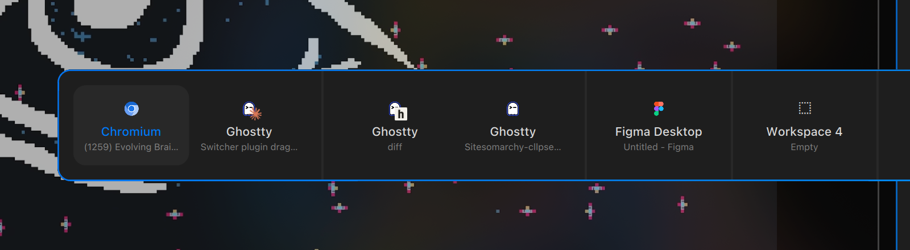

# Window Switcher

A macOS-style window switcher for the [Omarchy](https://omarchy.org) 4
(Quickshell) shell. Hold `SUPER`, tap `TAB` to cycle a horizontal strip of open
windows, release to focus the highlighted one — or throw the pointer into any
corner of the screen and the same strip opens with no key held. Click a tile to
focus it, or drag one onto another workspace to move it there.



- **Tiles are grouped by workspace**, sorted by on-screen position, with a rule
  between groups. Empty workspaces get a tile of their own.
- **`SUPER+TAB` alternates**, like every Alt-Tab: the first tap lands on the
  window or empty workspace you came from, further taps walk the strip. If that
  place is gone, the tap goes to the one before it. The tiles are never
  reordered to do it.
- **Drag to arrange.** Drop a tile on a workspace group to move the window
  there, on another window's tile to split it, or drag a workspace's handle to
  re-arrange the workspaces. A blue dot on each tile shows where that window
  sits while you drag. → [Dragging](docs/dragging.md)
- **Tiles show what is inside them.** A terminal tile carries the icon of the
  program running in it; a browser tile carries the favicon of its site.
  → [Terminal icons](docs/icons.md), [Site favicons](docs/favicons.md)

## Requirements

- Omarchy 4 (Quattro) and its Quickshell-based shell
- Hyprland, for `hyprctl` and the global-shortcuts protocol
- A Nerd Font as the shell's menu font, for the tile glyphs
- For site favicons only: `python3` with its `sqlite3` module (on Arch that is
  the `sqlite` package, an optional dependency of `python`). Without it every
  browser tile simply keeps its own icon and nothing else changes.

## Install

```bash
omarchy plugin add https://github.com/cllpse/omarchy-cllpse-plugin-switcher.git --enable
```

**Then install the keybinds.** Without them the only way in is the screen
corners (below) — the keyboard half registers three global shortcuts and waits
for the compositor to send them. Append
[`hypr/window-switcher-bindings.lua`](hypr/window-switcher-bindings.lua) to
`~/.config/hypr/bindings.lua`:

```bash
cat ~/.config/omarchy/plugins/cllpse.window-switcher/hypr/window-switcher-bindings.lua \
  >> ~/.config/hypr/bindings.lua
hyprctl reload
```

That file binds `SUPER+TAB` / `SUPER+SHIFT+TAB`, polls for the release of
`SUPER` to commit, and switches Omarchy's `SUPER + mouse:272` "Move window" bind
off while the strip is up so that clicks and drags reach the switcher instead.
It unbinds Omarchy's default `SUPER+TAB` (next workspace) first.

Optionally append
[`hypr/window-switcher-looknfeel.lua`](hypr/window-switcher-looknfeel.lua) to
`~/.config/hypr/looknfeel.lua` for a fade as the strip opens and closes. It
deliberately leaves blur off: on a full-screen layer it halves the frame rate of
every animation, and an opaque card has nothing to blur. The file explains, and
carries the rule commented out:

```bash
cat ~/.config/omarchy/plugins/cllpse.window-switcher/hypr/window-switcher-looknfeel.lua \
  >> ~/.config/hypr/looknfeel.lua
hyprctl reload
```

## Remove

```bash
omarchy plugin remove cllpse.window-switcher
```

Then delete the blocks you appended from `~/.config/hypr/bindings.lua` and
`~/.config/hypr/looknfeel.lua` and run `hyprctl reload`. Removing the bindings
block restores Omarchy's own `SUPER+TAB` and `SUPER + mouse:272` behaviour,
since this plugin only ever *rebinds* them at the end of your config. The plugin
writes nothing else of its own: no state files, no edits to `shell.json` beyond
the entry `omarchy plugin add --enable` makes for you. The one file it touches
is Omarchy's: re-arranging workspaces moves Omarchy's per-workspace layout files
along with the workspaces (see [Dragging](docs/dragging.md)), and those stay
Omarchy's after removal.

## Using it

| | |
|---|---|
| `SUPER+TAB` | open the strip / step forward |
| `SUPER+SHIFT+TAB` | step back |
| release `SUPER` | focus the highlighted window |
| pointer into **any screen corner** | open the strip, no key held |
| move the pointer | highlight the tile under it, once it has moved 16px and not within a quarter of a second of a key |
| scroll wheel | scroll the strip sideways when it is wider than the card |
| `SUPER` + click a tile | focus that window |
| `SUPER` + click beside the card | dismiss without switching |
| `SUPER` + drag a tile | move that window to the workspace you drop on |
| `SUPER` + drag a tile onto another window's tile | split that window: above, beside or below it, by the third of the tile you drop in |
| `SUPER` + drag a handle under the card | move that workspace to the place you drop it. Releasing `SUPER` afterwards switches nothing |

Opened from a corner there is no key to release, so nothing is pre-selected: the
strip opens on the window you are already in, and a click is what chooses.

A one-pixel layer surface sits in each corner of every screen, and nothing
polls. It stands down while a window on the focused workspace is fullscreen, and
costs the four corner pixels their click-through.
→ [The pointer and the screen corners](docs/pointer-and-corners.md)

## Theming

The card binds the active theme's menu colours and Hyprland's `decoration:rounding`,
so it tracks your theme with nothing to configure. Four sizes can be pinned
from a theme's `[spacing]` section if you want them different:

| token | default | what it sets |
|---|---|---|
| `switcher-cell-width` | 150 | tile width |
| `switcher-group-gap` | derived | extra space between workspace groups; by default sized so a group's divider sits `switcher-card-padding` from the tiles either side, as the border does |
| `switcher-row-height` | 104 | tile height floor |
| `switcher-card-padding` | 6 | space between the card's border and the tiles |

The highlight's corner is concentric with the card's: Hyprland's rounding, less
the distance from the card's edge in to the tiles (border plus
`switcher-card-padding`). Padding at or past the rounding gives square
highlights.

## Notes

- The plugin runs inside the existing Omarchy shell process and starts no
  Quickshell of its own. It shells out to `hyprctl` to focus and move windows
  and to renumber workspaces, once at startup to index your icon themes, once on first sight of a browser
  window to find profiles, and to `favicons.py` when a browser page title it has
  no answer for appears. **Opening the strip spawns nothing** — a lookup is
  triggered by a page title changing, not by activation, and is skipped when
  every title on screen already has an answer. Profiles are found once per
  session (28ms) and cached for it; a lookup is ~17ms, of which under half a
  millisecond is the query and the rest is Python starting.
- **One overlay at a time.** Opening the strip sends
  `custom>>overlay-open>>cllpse.window-switcher` on Hyprland's event socket
  (`hl.dsp.event`), and the strip closes without switching when another
  overlay sends the same event with its own id. The last one opened wins.
  [Supermenu](https://github.com/cllpse/omarchy-cllpse-plugin-supermenu) does
  this too, so `SUPER+SPACE` over the strip cancels it. Neither plugin names
  the other. To close the strip from a shell:
  `hyprctl dispatch 'hl.dsp.event("overlay-open>>x")'`.
- Windows on special workspaces (the scratchpad) are deliberately not listed.
- Live edits inside a plugin directory may not auto-reload; run
  `omarchy-restart-shell` after changing files here.

## More

| | |
|---|---|
| [Dragging](docs/dragging.md) | Moving windows, splitting, the position dots, re-arranging workspaces |
| [The pointer and the screen corners](docs/pointer-and-corners.md) | Hover rules, how the corners work and what they cost |
| [Terminal icons](docs/icons.md) | Where icons are looked up, adding your own, the alias table |
| [Site favicons](docs/favicons.md) | What access to your history this needs, and what it never touches |
| [`AGENTS.md`](AGENTS.md) | The icon contract |

## License

MIT — see [LICENSE](LICENSE).
